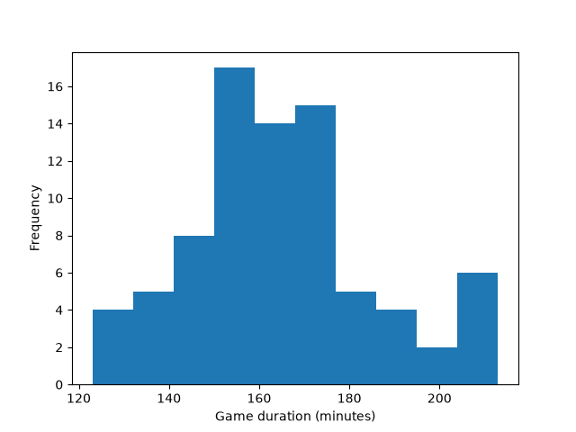
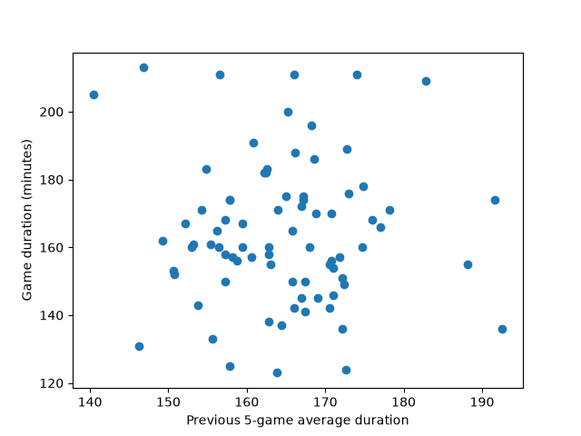
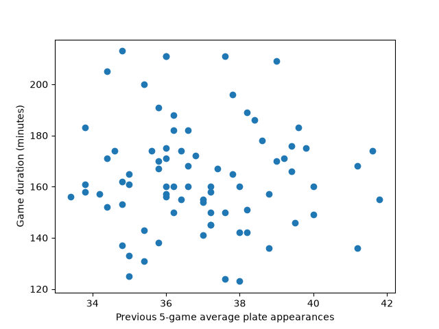

# Model Report: Los Angeles Angels Home Game Duration Prediction

## Business Question
How many minutes should Los Angeles Angels game-day operations expect an upcoming home game at Angel Stadium to last?

The prediction target is `duration_minutes`, with one Los Angeles Angels home game represented by each row in the machine learning table. The project uses regular-season games from 2023 through 2025 because the MLB pitch clock began in 2023 creating a different game-timing environment than earlier seasons.

The data is split by season:
- **Train:** 2023, 80 games
- **Validate:** 2024, 81 games
- **Test:** 2025, 81 games

The first 2023 Angels home game remains in the historical tables but is excluded from the machine learning table because there is no earlier post pitch clock Angels home-game history available.

## Training Data Exploration
All exploratory charts use only the training data.

### Game Duration Distribution

Most 2023 Angels home games lasted roughly 145–180 minutes, with a smaller number of games lasting more than 200 minutes.

### Game Duration vs. Previous 5-Game Average Duration

Game durations are spread widely across the previous five-game averages, so there does not appear to be a strong relationship in the training data.

### Game Duration vs. Previous 5-Game Average Plate Appearances

Game durations are also spread widely across the previous five-game average plate appearances, with no clear strong relationship in the training data.

## Error Measure and Baseline
Mean absolute error (MAE) is used because game duration is a numeric target. MAE shows in minutes how far the model predictions are from the actual game durations on average.

The baseline uses the average duration from the 2023 training games as the prediction for every validation game. The training average was **164.19 minutes**, and the baseline validation MAE was **13.44 minutes**.

## Model Comparison
Three regression models were trained on the 2023 data and evaluated using the 2024 validation data.

| Model | Validation MAE |
|---|---:|
| Baseline | **13.44 minutes** |
| Linear Regression | 17.65 minutes |
| KNN Regression | **16.51 minutes** |
| Decision Tree Regression | 30.05 minutes |

KNN Regression had the lowest validation MAE among the three predictive models and was selected before looking at the test result. However, none of the three predictive models outperformed the baseline.

## Final Model and Test Results
- The selected KNN Regression model had a validation MAE of **16.51 minutes**.
- The model was then evaluated once using the 2025 test data and produced a test MAE of **16.02 minutes**.
- The validation and test results differ by only about 0.49 minutes so the model performed similarly on the unseen test data. However, the model still did not improve on the simple validation baseline of 13.44 minutes.

## Feature Interpretation
KNN Regression does not provide coefficients or built-in feature importance, so standardized Linear Regression coefficients were used to help interpret the features.

The features with the largest coefficient magnitudes were:
| Feature | Standardized Coefficient |
|---|---:|
| Start hour | 24.01 |
| Night game | -23.65 |
| Previous 5-game average duration | -5.49 |
| Previous 5-game average total runs | 4.84 |
| Temperature | 2.88 |

Game timing variables had the strongest relationship with duration in the interpretation model. Start hour and night game status have overlap so their individual coefficients should be interpreted with caution. Recent average game duration and recent scoring also showed relationships with game duration, while precipitation had essentially no relationship in this interpretation model.

These relationships are useful for understanding the model inputs but do not establish causation.

## Limitations and Next Steps
- The main limitation is the amount of comparable training history. Only post pitch clock seasons are included, leaving 80 games in the training set. 
- The current feature set also did not allow any of the three predictive models to outperform the simple baseline.

- Post Pitch Clock seasons would provide more training observations and could improve future modeling. 
- Features related to game conditions or matchup characteristics could also be evaluated in future versions of the project.
- For an actual future game prediction, weather related features would need to come from forecast information rather than observed historical weather.